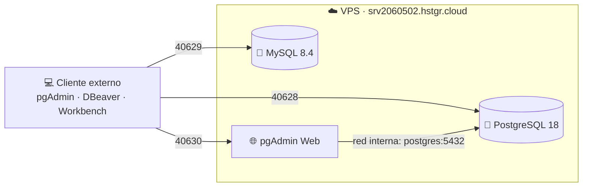

<div align="center">

# 🗄️ Bases de Datos en la Nube

### PostgreSQL · MySQL · pgAdmin Web sobre un VPS con Docker Compose


**Universidad Tecnológica de Xicotepec de Juárez**
Ingeniería en Tecnologías de la Información e Innovación Digital
Optativa I · Bases de Datos en la Nube

</div>

---

## 📌 Descripción

Despliegue y administración de servicios de bases de datos relacionales en un **VPS compartido**, usando **Docker Compose** con configuración propia e independiente. El proyecto incluye PostgreSQL, MySQL Server y pgAdmin Web, la base de datos de e-commerce `db_test` con su bitácora de trazabilidad, y la administración de roles, cuentas y privilegios en los dos motores.

## 🧱 Arquitectura



## 🔌 Servicios y puertos

| Servicio | Contenedor | Puerto publicado | Puerto interno | Criterio del puerto |
|---|---|---|---|---|
| 🐘 PostgreSQL 18 | `pg_240628` | **40628** | 5432 | Cinco dígitos de la matrícula |
| 🐬 MySQL 8.4 | `mysql_240628` | **40629** | 3306 | Cinco dígitos de la matrícula + 1 |
| 🌐 pgAdmin 4 Web | `pgadmin_240628` | **40630** | 80 | Puerto libre elegido |

Cada servicio guarda sus datos en un **volumen persistente** (`pg_data`, `mysql_data` y `pgadmin_data`), por lo que no se pierden al recrear los contenedores.

## 📁 Estructura del repositorio

```text
Manual_VPS_BDs_Relacionales/
├── 📄 Reporte_Unidad1_240628.pdf   # reporte técnico individual
├── 🚫 .gitignore     
├── 📄 Respaldo-20261026.sql 
├── 📘 README.md
└── 📂 PgAdmin/
    ├── 01_equema.sql
    ├── 02_datos.sql
    ├── 03_logica.sql
    
```

## ⚙️ Requisitos

- 🐧 Un VPS con Linux y acceso por SSH
- 🐳 Docker Engine y Docker Compose
- 🔧 Git
- 💻 Un cliente de base de datos en tu computadora (pgAdmin de escritorio o DBeaver para PostgreSQL, y MySQL Workbench para MySQL)

## 🚀 Despliegue paso a paso

```bash
# 1. Clonar el repositorio y entrar a la rama de trabajo
git clone <url-del-repositorio>
cd <carpeta-del-repositorio>
git checkout Manual_VPS_BDs_Relacionales

# 2. Crear el archivo de variables y poner tus valores reales
cp .env.example .env
nano .env
chmod 600 .env

# 3. Validar la configuración
docker compose config --quiet && echo "OK"

# 4. Levantar los servicios
docker compose up -d

# 5. Comprobar que todo está en ejecución
docker compose ps
docker compose logs --tail 50
```

Al terminar, `pg_240628` y `mysql_240628` deben aparecer como **healthy**, y los tres contenedores en **Up**.

## 🔗 Conexión

Desde un cliente externo al VPS:

| Motor | Host | Puerto | Base de datos |
|---|---|---|---|
| 🐘 PostgreSQL | `srv2060502.hstgr.cloud` | `40628` | `db_test` |
| 🐬 MySQL | `srv2060502.hstgr.cloud` | `40629` | `db_test` |
| 🌐 pgAdmin Web | `http://srv2060502.hstgr.cloud:40630` | `40630` | — |

> 💡 Dentro de pgAdmin Web el servidor PostgreSQL se registra con el host `postgres` y el puerto `5432`, porque se conecta por la red interna de Docker.

## 🗃️ Base de datos `db_test`

Base de e-commerce con **21 tablas**, **19 vistas de trazabilidad** (`vw_trazabilidad_*`), **6 procedimientos almacenados** y **triggers de auditoría** que registran cada inserción, actualización y eliminación en la tabla `tb_logs`.

| Objeto | Descripción |
|---|---|
| 👤 `tb_users`, `tb_people` | Cuentas y datos personales |
| 📦 `tb_products`, `tbc_categories` | Catálogo de productos y categorías |
| 🛒 `tb_carts`, `tbd_shopping_cart` | Carritos de compra |
| 🧾 `tbb_orders`, `tbd_payments` | Órdenes y pagos |
| 📝 `tb_logs` | Bitácora de operaciones |
| 🔍 `vw_trazabilidad_*` | Una vista de trazabilidad por tabla auditada |

### 🔐 Roles y privilegios

| Rol | Privilegios |
|---|---|
| `superadmin` | Todos, sobre todo el servidor |
| `admin` | Todos, sobre `db_test` |
| `support` | Gestión de usuarios y categorías; actualización de productos; baja lógica de usuarios |
| `seller` | Alta y edición de productos; consulta de categorías |
| `user_not_registered` | Alta de usuarios y personas |
| `buyer`, `common` | Creados sin privilegios |

Las cuentas personales son un superadmin, un admin, dos seller y un support, con los roles asignados en los dos motores.

## 🐘 Carga en PostgreSQL

Los scripts de PostgreSQL son una conversión de la base de MySQL: usan `IDENTITY`, `boolean`, ENUM propios, una función genérica de auditoría y vistas que consultan `pg_auth_members`. Se ejecutan en este orden:

1. 🧱 Tipos, tablas, índices y llaves foráneas
2. ⚙️ Funciones, triggers, procedimientos y vistas
3. 🔐 Roles, cuentas y privilegios

```bash
docker exec -i pg_240628 psql -U "$PG_ADMIN_USER" -d db_test -v ON_ERROR_STOP=1 < sql/postgresql.sql
```

## 🐬 Carga en MySQL

```bash
docker exec -i mysql_240628 mysql -uroot -p < sql/mysql.sql
```

> ⚠️ MySQL 8.4 prohíbe por defecto las llaves foráneas que apuntan a columnas no únicas, algo que MySQL 8.0 permitía. Si al cargar aparece el error `6125`, ejecuta antes `SET SESSION restrict_fk_on_non_standard_key=OFF;` en la misma sesión.

## ✅ Verificación rápida

```sql
-- PostgreSQL
SELECT version(), current_database(), current_user;
SELECT * FROM vw_trazabilidad_productos ORDER BY operation_date DESC LIMIT 10;

-- MySQL
SELECT VERSION(), CURRENT_USER(), DATABASE();
SHOW TABLES;
SHOW TRIGGERS FROM db_test;
```

## 🛡️ Seguridad

- 🚫 **No se suben contraseñas, claves privadas ni secretos.** El archivo `.env` está en `.gitignore`; solo se entrega `.env.example` con valores de ejemplo.
- 🔑 Los scripts SQL no contienen contraseñas reales. Las credenciales de prueba se entregan por un canal autorizado y seguro.
- 🔒 Los respaldos con datos reales de usuarios se guardan fuera del repositorio.

## 🧪 Pruebas

Los diez casos de prueba de clase sobre `tb_users` y `tb_products`, con sus consultas, resultados y capturas, están documentados en el reporte técnico (`Reporte_Unidad1_240628.pdf`).

## 👤 Autor

| | |
|---|---|
| **Estudiante** | Jose Maria Hernandez Castillo |
| **Matrícula** | 240628 |
| **Grupo / equipo** | 7 A / Grupo |
| **Docente** | Marco Antonio Ramirez Hernandez |

---

<div align="center">

🎓 **UTXJ** · Ingeniería en Tecnologías de la Información e Innovación Digital

</div>
