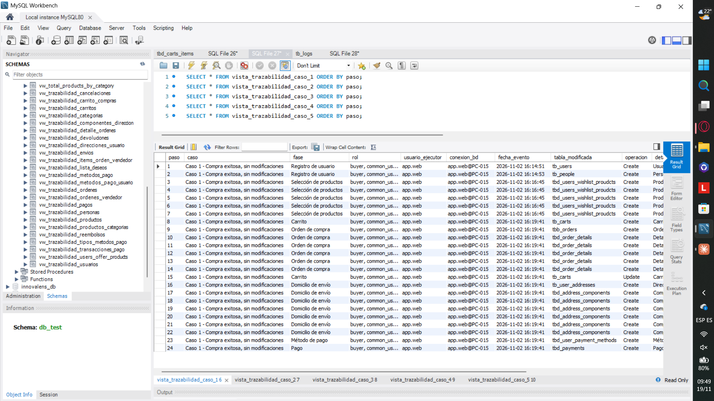
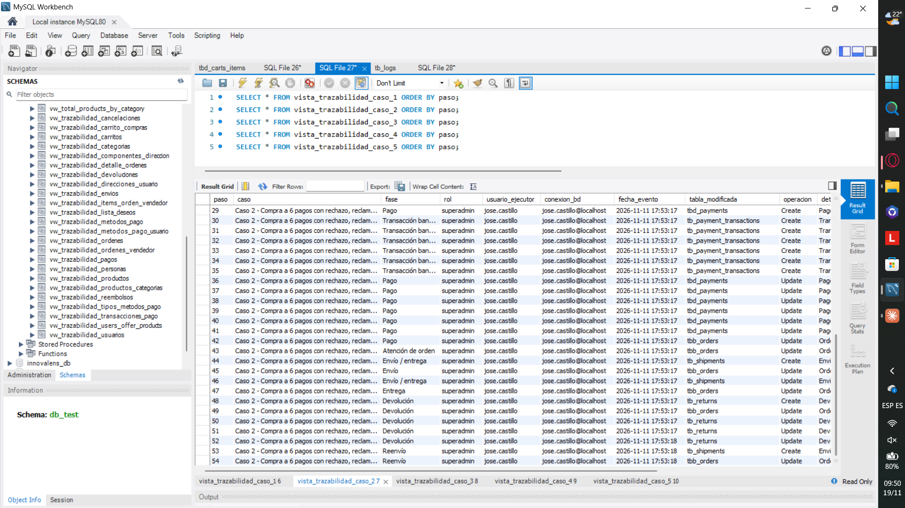
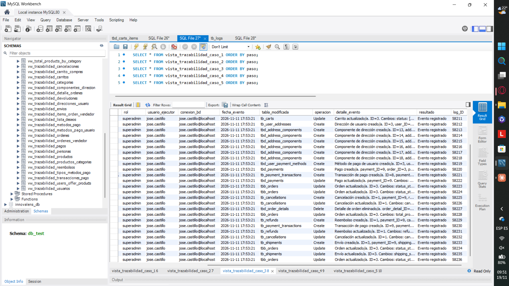
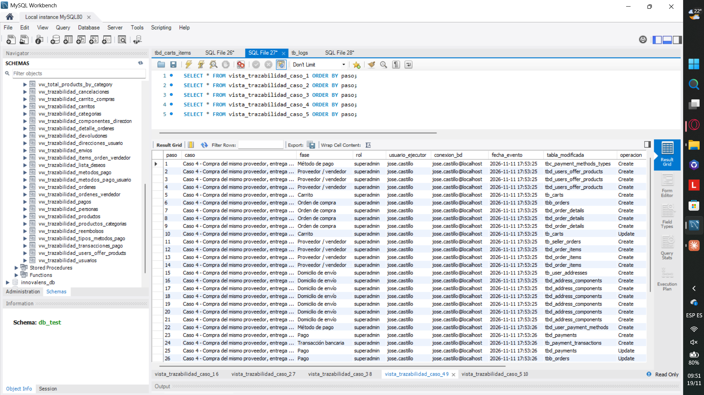
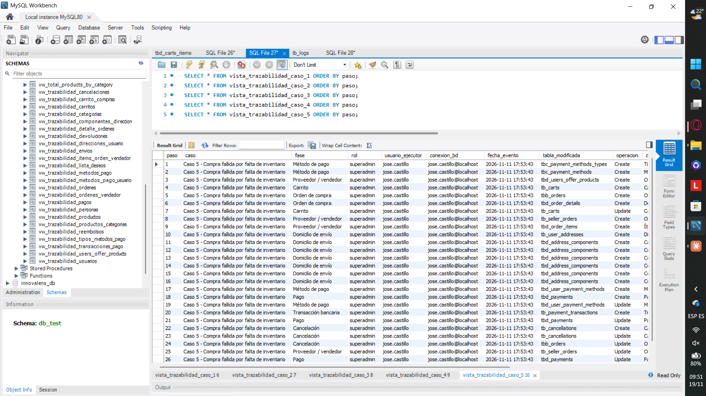

# Práctica 04 — Casos de Prueba de Compra (db_test)

Base de datos **db_test** (MySQL 8.x, InnoDB, `utf8mb4`) de un E-Commerce. En esta práctica se simulan 5 casos de prueba del flujo de compra, desde la creación del carrito hasta la entrega, la cancelación o la devolución. Todos los cambios quedan registrados en `tb_logs` mediante los triggers de auditoría.

## Contenido de la carpeta

```
Practica04/
├── Backups/                               # Respaldos de la base de datos
│   ├── Respaldo-20261102.sql
│   ├── Respaldo-20261102(2).sql
│   ├── Respaldo-20261111.sql
│   ├── Respaldo-20261112.sql
│   ├── Respaldo-20261118.sql
│   ├── Respaldo-20261119.sql
│   └── Respaldo-20261119 (2).sql          # Respaldo más reciente
├── Evidencia/                             # Capturas de las vistas de trazabilidad por caso
│   ├── Caso1.png
│   ├── Caso2.png
│   ├── Caso3.png
│   ├── Caso4.png
│   └── Caso5.png
├── queries/
│   └── consulta_de_verificacion.sql
├── scripts/
│   └── remote_users_privileges_creation.sql
├── seeds/
│   └── productos_5000.csv
├── diagrama_er_db_test.html               # Diagrama Entidad-Relación interactivo
├── diccionario_datos_interactivo.html     # Diccionario de datos interactivo
└── README.md
```

Los dos HTML tienen un botón en la parte superior para pasar de uno al otro. Ambos están actualizados con el respaldo `Respaldo-20261119 (2).sql`: 25 tablas, 211 columnas, 36 llaves foráneas, 72 triggers y 32 vistas (24 de trazabilidad por tabla, 7 de los casos de prueba y 1 de catálogo).

---

## Caso de Prueba 1: "Compra exitosa, sin modificaciones"

1. Un usuario nuevo se registra en la plataforma con sus datos personales y de cuenta de usuario (rol: `user_not_registered`; usuario de conexión a la BD: `AppWeb` o `AppMobile`).
2. El usuario creado selecciona 5 productos disponibles (de aproximadamente 10,000) y se verifica su estatus.
3. El usuario crea 1 carrito de compra.
4. El usuario agrega los 5 productos al carrito, con diferentes cantidades.
5. El usuario realiza la orden de compra.
6. El usuario registra su domicilio para el envío.
7. El usuario registra su método de pago: **tarjeta de débito**, con una cuenta simulada de 16 dígitos (vinculada a su tabla dependiente).
8. El usuario registra un **pago único**. Al pagar, el usuario de conexión activa el rol `buyer`.
9. El sistema registra la transacción bancaria y la autoriza.
10. El sistema procesa la orden y la marca como atendida.
11. El usuario recibe el producto en casa.

## Caso de Prueba 2: "Compra con detalles en el último pago, con reclamación y reenvío"

1. Un usuario ya registrado (de los 10k disponibles) crea 1 carrito de compra con 10 productos aleatorios, con cantidades de 1 a 5 unidades.
2. El usuario realiza la orden de compra.
3. El usuario registra un domicilio de envío que no es su hogar (por ejemplo, la dirección de su trabajo).
4. El usuario registra su método de pago: **tarjeta de crédito**, con una cuenta simulada de 16 dígitos (vinculada a su tabla dependiente).
5. El usuario registra **6 pagos mensuales**. Al pagar, el usuario de conexión activa el rol `buyer`.
6. El sistema registra las transacciones bancarias: autoriza 5 y rechaza la última por **"límite de crédito excedido"**.
7. El sistema procesa la orden y la marca como atendida.
8. El usuario recibe el producto en casa.
9. El usuario reclama la devolución de un producto que llegó dañado.
10. El sistema reenvía el producto en buenas condiciones.

## Caso de Prueba 3: "Compra exitosa con cancelación parcial, ajuste y reembolso parcial"

1. Un usuario ya registrado (de los 10k disponibles) crea 1 carrito de compra con 3 productos **de la misma categoría**, con cantidades de 1 a 10 unidades.
2. El usuario realiza la orden de compra.
3. El usuario registra un domicilio de envío que no es su hogar (por ejemplo, la dirección con la etiqueta **"Casa Papas"**).
4. El usuario registra su método de pago: **tarjeta digital (Spin)**, con una cuenta simulada de 16 dígitos (vinculada a su tabla dependiente).
5. El usuario registra un **solo pago en efectivo** por el costo total de la compra.
6. El sistema procesa la orden y la marca como atendida.
7. El usuario cancela un producto del pedido.
8. El sistema actualiza la orden de compra.
9. El sistema reembolsa el monto de los productos cancelados.
10. El sistema realiza el envío.
11. El cliente recibe el pedido en casa.

## Caso de Prueba 4: "Compra exitosa del mismo proveedor con entrega en el punto de recolección"

1. Un usuario ya registrado (de los 10k disponibles) crea 1 carrito de compra con 3 productos **del mismo proveedor**, con cantidades de 1 a 3 unidades.
2. El usuario realiza la orden de compra.
3. El usuario registra como domicilio de envío su hogar.
4. El usuario registra su método de pago: **transferencia SPEI**, con una cuenta simulada de 16 dígitos (vinculada a su tabla dependiente).
5. El usuario registra un **solo pago en efectivo** por el costo total de la compra.
6. El sistema procesa la orden y la marca como atendida.
7. El sistema realiza el envío.
8. Como no hubo quien recibiera el pedido, el cliente lo recoge en el **punto de recolección**.

## Caso de Prueba 5: "Compra fallida por falta de inventario"

1. Un usuario ya registrado (de los 10k disponibles) crea 1 carrito de compra con 1 producto, con cantidades de 1 a 5 unidades.
2. El usuario realiza la orden de compra.
3. El usuario registra como domicilio de envío su hogar.
4. El usuario registra su método de pago: **cupón de regalo**.
5. El sistema procesa la orden y la marca como **no atendida por falta de inventario**.
6. El sistema cancela la orden y reasigna el cupón utilizado.

---

## Resumen de los casos

| Caso | Escenario | Productos | Método de pago | Pagos | Entrega | Resultado |
|---|---|---|---|---|---|---|
| 1 | Compra exitosa sin modificaciones | 5 (usuario nuevo) | Tarjeta de débito | 1 | Domicilio | Exitosa |
| 2 | Último pago rechazado, reclamación y reenvío | 10 aleatorios | Tarjeta de crédito | 6 mensuales | Trabajo | Exitosa con devolución y reenvío |
| 3 | Cancelación parcial y reembolso | 3 de la misma categoría | Tarjeta digital (Spin) | 1 en efectivo | "Casa Papas" | Exitosa con reembolso parcial |
| 4 | Mismo proveedor | 3 del mismo proveedor | Transferencia SPEI | 1 en efectivo | Punto de recolección | Exitosa |
| 5 | Falta de inventario | 1 | Cupón de regalo | — | Domicilio | Fallida, cupón reasignado |

---

## Evidencias

Las capturas de la carpeta `Evidencia/` muestran, en MySQL Workbench sobre `db_test`, el resultado de las vistas de trazabilidad de cada caso de prueba. Cada vista numera los eventos registrados en `tb_logs` (columna `paso`) y muestra la fase, el rol, el usuario ejecutor, la conexión, la fecha, la tabla modificada, la operación y el detalle del evento.

Consulta utilizada:

```sql
SELECT * FROM vista_trazabilidad_caso_1 ORDER BY paso;
SELECT * FROM vista_trazabilidad_caso_2 ORDER BY paso;
SELECT * FROM vista_trazabilidad_caso_3 ORDER BY paso;
SELECT * FROM vista_trazabilidad_caso_4 ORDER BY paso;
SELECT * FROM vista_trazabilidad_caso_5 ORDER BY paso;
```

### Caso de Prueba 1 — Compra exitosa, sin modificaciones



### Caso de Prueba 2 — Compra a 6 pagos con rechazo, reclamación y reenvío



### Caso de Prueba 3 — Compra con cancelación parcial, ajuste y reembolso



### Caso de Prueba 4 — Compra del mismo proveedor, entrega en punto de recolección



### Caso de Prueba 5 — Compra fallida por falta de inventario



El resumen de eventos por caso y fase se puede consultar con:

```sql
SELECT * FROM vista_trazabilidad_resumen_casos;
```
